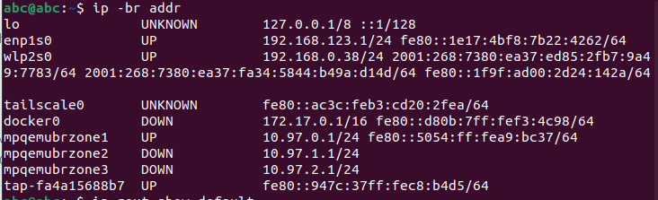
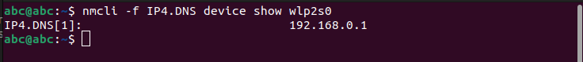
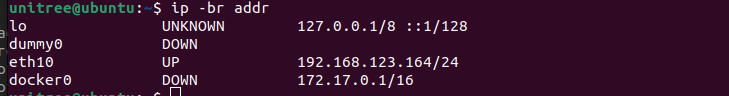
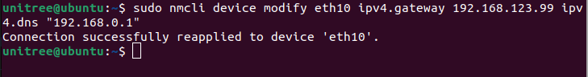
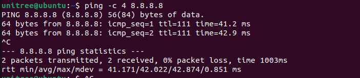

##connect the R1 to the internet

#make sure you are connecting the r1 with ethernet. 
#This process is temporary. After you restart the R1, it goes back to default settings.

#For ubuntu
#Check the network interface name
```bash
ip -br addr
ip rout show default
```


R1 is connected to enp1ss0. The wifi is connected to wlp2so.

#set the wired LAN Ip address of your PC(Ubuntu) to the wired LAN side of your PC

```bash
sudo ip addr replace 192.168.123.99/24 dev enp1s0
sudo ip link set enp1s0 up

```
This will allow PC to forward communications received from R1 wired LAN to the Wifi network.
```bash
sudo sysctl -w net.ipv4.ip_forward=1

```
We will add NAT settings that routes traffic leaving the R1 network to the outside as traffic on the Wifi side of the PC

```bash
sudo iptables -t nat -C POSTROUTING -s 192.168.123.0/24 -o wlp2s0 -j MASQUERADE 2>/dev/null || sudo iptables -t nat -A POSTROUTING -s 192.168.123.0/24 -o wlp2s0 -j MASQUERADE

```
This allows communication from the R1 to the wifi network.
```bash
sudo iptables -C FORWARD -i enp1s0 -o wlp2s0 -s 192.168.123.0/24 -j ACCEPT 2>/dev/null || sudo iptables -A FORWARD -i enp1s0 -o wlp2s0 -s 192.168.123.0/24 -j ACCEPT

```
This allows the return of communication that has left R1 to an external source
```bash
sudo iptables -C FORWARD -i wlp2s0 -o enp1s0 -d 192.168.123.0/24 -m conntrack --ctstate ESTABLISHED,RELATED -j ACCEPT 2>/dev/null || sudo iptables -A FORWARD -i wlp2s0 -o enp1s0 -d 192.168.123.0/24 -m conntrack --ctstate ESTABLISHED,RELATED -j ACCEPT

```
This displays the configuration status on you PC

```bash
ip -4 addr show enp1s0
cat /proc/sys/net/ipv4/ip_forward
sudo iptables -t nat -S
sudo iptables -S FORWARD

```
check the DNS of your PC
```bash
nmcli -f IP4.DNS device show wlp2s0

```


##SSH into the R1
```bash
ssh unitree@192.168.132.164

```
#check the wired LAN interface name
```bash
ip -br addr
```


##Temporarily set the value obtained from the Wifi DNS of your PC to the wired R1
```bash
sudo nmcli device modify eth0 ipv4.gateway 192.168.123.99 ipv4.dns "192.168.0.1"

```


#check if the internet is working 
```bash

ping -c 4 8.8.8.8

```

###For checking brainco hand

#Download and build the brainco hand sdk
```bash
git clone https://github.com/BrainCoTech/brainco-hand-sdk.git
cd brainco-hand-sdk.git/
./download-lib.sh

```
build it
```bash
cd c/
make

```
#run the hand demo

```bash
# Left hand
sudo ./hand_demo.exe -m /dev/ttyCH343USB0 460800 126 0

# Right hand 
sudo ./hand_demo.exe -m /dev/ttyCH343USB1 460800 127 0

```

### Demo list

| Number | What happens |
|---|---|
| *(nothing)* | Runs all demos |
| `1` | Make a fist, open hand, move one finger |
| `2` | Speed and force control |
| `3` | Advanced movements |
| `4` | Built-in gestures (fist, pinch, point…) |
| `5` | Show hand info (no movement) |
| `6` | Read touch sensors |
| `7` | **Open/close loop forever** |


